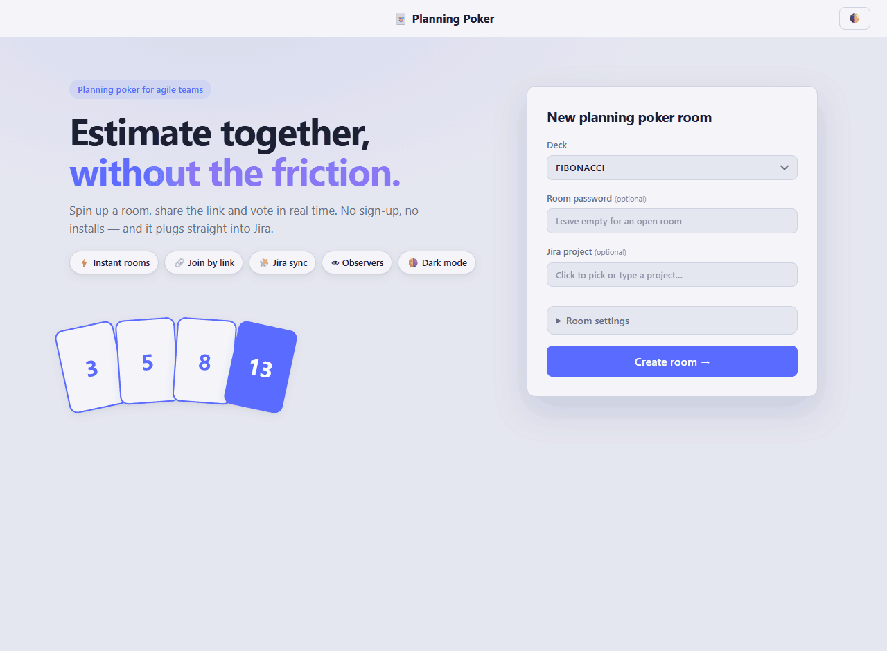

# Planning Poker

FastAPI + WebSocket, vanilla JS front (no build step). Rooms live in memory (a restart drops them; idle rooms are removed after 24h).



## Run

Needs Python 3. Run from the project root. Only the activation line differs by OS.

```
python -m venv .venv
```

Activate the venv:

- Linux / macOS: `source .venv/bin/activate`
- Windows: `.venv\Scripts\activate.bat`

```
python -m pip install -r requirements.txt
python poker.py
```

Optional: copy `.env.example` to `.env` to set `HOST` / `PORT` (default `0.0.0.0:8000`, open to your network) and the Jira credentials.

(If `python` isn't found, try `python3`, or `py` on Windows. The venv is created and the dependencies installed once; next time just activate and start the server.)

Open http://localhost:8000, create a room, share the `/<uuid>` link. Stop with `Ctrl+C`.

## Features
- Room id is a UUID; join by link, only a name is required; optional room password (owner can change it via 🔒).
- Decks: fibonacci, t-shirt, powers of 2; observers; reveal / new round; average, median, consensus.
- Dark / light theme (follows OS by default).
- Jira: the room owner picks a project (its fields fill the Estimate and Additional-fields dropdowns; JQL defaults to that project, editable) and the estimate field right in the UI, anyone picks the current issue, the owner pushes the final estimate to that field.

## Notes
- Jira credentials live only on the server (`.env`). Anyone who can create a room can run JQL with them — deploy behind your VPN/SSO.
- The room owner is the browser that created the room (identified by a random id in localStorage).
- Run a single worker (state is in-process). Put it behind HTTPS with WebSocket proxying for production.

```
pip install -r media/requirements.txt
playwright install chromium
python media/make_gif.py
```
